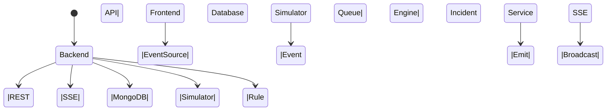

# Architecture Overview

## Components
- **Backend (Express)** – Handles REST endpoints (`/api/devices`, `/api/events`, `/api/rules`, `/api/incidents`, `/api/health`) and the SSE stream (`/api/stream`).
- **Frontend (React + Vite)** – Consumes the REST APIs and subscribes to the SSE stream to update device status, events, incidents and statistics in real time.
- **MongoDB** – Stores devices, events, rules and incidents.
- **Simulator (`server/src/simulator/cli.js`)** – Generates synthetic events, can disconnect temporarily, buffers events offline in `simulator_state.json`, and flushes them on reconnection.
- **Rule Engine (`server/src/services/ruleEngine.js`)** – Evaluates incoming events against defined rules (threshold, type, device‑scoped) and creates incidents. Handles deduplication.
- **Offline Monitor (`server/src/services/offlineMonitor.js`)** – Periodically checks device last‑seen timestamps to mark devices offline.

## Event Flow
1. **Ingestion** – `POST /api/events` validates payload, stores the event, updates device `lastSeenAt` and `status`.
2. **SSE Emission** – After successful ingestion, `eventBus.emit('update', {kind:'event', data:newEvent})` and `eventBus.emit('update', {kind:'device', data:device})` trigger SSE broadcast.
3. **Rule Evaluation** – `evaluateRules({event, device})` runs rule checks; if a rule matches, an incident is created and emitted via SSE (`kind:'incident'`).
4. **Duplicate Handling** – Event model has a unique index on `eventId`. Duplicate ingestion returns HTTP 409 and does not create a new incident.
5. **Out‑of‑Order Handling** – Device `lastSeenAt` is only updated if the incoming timestamp is newer, preventing backward time updates.

## Offline & Simulator Flow
- The simulator writes events to a local queue when disconnected.
- On reconnection, queued events are replayed in order, invoking the same ingestion path, thus benefitting from duplicate and ordering safeguards.
- `offlineMonitor` runs every minute (except in test mode) to mark devices as offline when no recent events are received.

## Reliability Limitations
- Offline buffer is a local JSON file; not durable across multiple server instances.
- Event ordering relies on client timestamps; extreme clock drift can cause out‑of‑order timestamps, but `lastSeenAt` guard prevents regressions.
- No horizontal scaling; a single instance handles all SSE connections.
- No authentication/authorization, TLS, or rate‑limiting – out of scope for the assignment.
